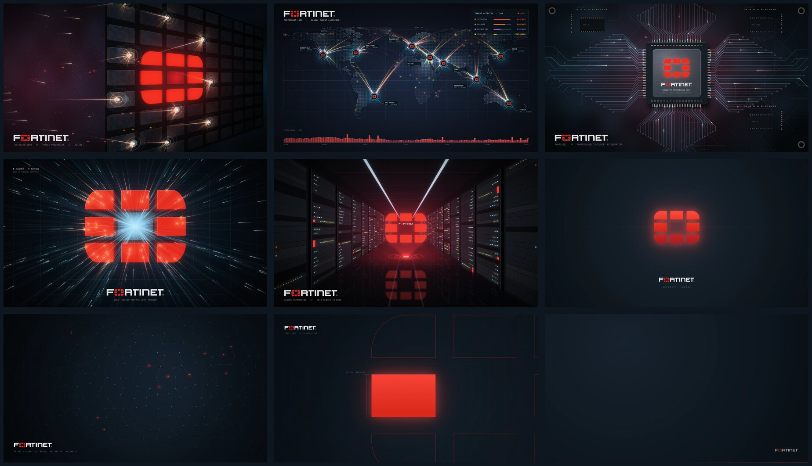

# Fortinet for Omarchy

A dark [Omarchy](https://omarchy.org) theme based on Fortinet's colors: slate-navy surfaces, with Fortinet Red kept for whatever has focus.


## Install

```sh
omarchy theme install https://github.com/charbelsarkis/omarchy-fortinet-theme
```

Or pick it from **Menu → Install → Style → Theme** once it's listed on [themes.omarchy.org](https://themes.omarchy.org).

## What you get

- **Palette.** Built from the Fortinet brand colors (Fortinet Red, slate, teal, blue, purple). The syntax colors pass WCAG AA contrast (4.5:1), and the dim text used for comments and autosuggestions is still readable (3.5:1).
- **Shell.** The bar, launcher, menus, notifications, popups, polkit prompt and lock screen are styled by hand. Controls are neutral at rest and only turn red on hover, focus or selection.
- **btop.** Gauges go from teal through orange to red. Memory is blue (free) and purple (cached), and network upload is red.
- **Boot unlock screen.** Ships the Fortinet wordmark. Turn it on under **Menu → Appearance → Unlock**.
- **Extras.** The Yaru-red icon set, a matching Chromium tint and a red keyboard backlight color.
- **Nine wallpapers,** four of them 4K vector art:



| # | Name | |
|---|------|---|
| 1 | firewall | The logo on a firewall face, under fire |
| 2 | threatmap | A global threat map |
| 3 | asic | A security processor (SPU) |
| 4 | gateway | Traffic streaming through the logo |
| 5 | datacenter | A server aisle |
| 6 | sentinel | Centered logo with a soft glow (4K) |
| 7 | fabric | A Security Fabric network map (4K) |
| 8 | segments | An oversized logo outline, blueprint style (4K) |
| 9 | stealth | Nearly blank, for focused work (4K) |

Cycle through them with **Menu → Appearance → Background**.

## Optional: the red window glow

Omarchy doesn't load Lua files from themes installed with `omarchy theme install`. The red border gradient comes from `colors.toml` and works as is, but the soft red glow around the focused window doesn't. To get it, add this to `~/.config/hypr/looknfeel.lua`. Note that it applies to every theme, not just this one.

```lua
hl.config({
  decoration = {
    shadow = {
      enabled = true,
      range = 12,
      render_power = 3,
      color = "rgba(da291c40)",
      color_inactive = "rgba(03070b99)",
    },
  },
})
```

## Remove

Switch to another theme, then delete the folder:

```sh
rm -rf ~/.config/omarchy/themes/fortinet
```

## Disclaimer

This is an unofficial fan theme. It isn't affiliated with, endorsed by or sponsored by Fortinet, Inc. Fortinet, the Fortinet logo, FortiGate, FortiGuard and Security Fabric are trademarks of Fortinet, Inc. They appear here only to say what the theme is inspired by.

The MIT license covers the theme's configuration files. It doesn't cover Fortinet's trademarks.
